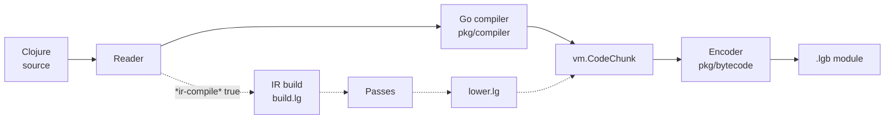

# Bytecode Compiler

The let-go compiler turns Clojure source into bytecode for the [stack VM](stack-vm.md). The source tree contains two compilation paths:

- **Default path.** The Go compiler in `pkg/compiler` reads forms with the reader and emits `vm.CodeChunk` bytecode directly from them. `lg` uses this path unless `*ir-compile*` is set.
- **IR path (opt-in).** When `*ir-compile*` is true, forms are built into an [Indexed-RPN IR](indexed-rpn-ir.md) implemented in Lisp under `pkg/rt/core/ir`, run through optimization passes, and lowered to bytecode by `lower.lg`. `*ir-compile*` is defined with default `false` in `pkg/rt/core/core.lg`.

Both paths produce `vm.CodeChunk` values. `pkg/bytecode` serializes them to `.lgb` modules. Bytecode can also be bundled into a standalone binary with `lg -b`, or compiled to a WASM web app with `lg -w`. Native executables from `lg compile` go through the IR lowering to Go.

## Pipeline

1. **Reader** (`pkg/compiler/reader.go`): Parses Clojure source into `vm.Value` forms: symbols, keywords, lists, vectors, maps, and sets. Supported reader macros include quote, syntax-quote, unquote, deref, `#_` discard, `#'` var quote, `#"` regex literals, `^` metadata, `#?` and `#?@` reader conditionals, and tagged literals (`pkg/compiler/tagged_reader.go`).
   - Reader conditionals always match `:lg` and `:default`. The `:clj` branch matches only when `LG_READ_CLJ` is set (or `SetMatchCljConditional` is called). The `:bb` branch matches only when `LG_READ_BB` is set.
   - The compiler rejects end of input inside an unfinished top-level form (commit subject at b82588292b, #1021).

2. **Default emission: Go compiler** (`pkg/compiler/compiler.go`): `Context.CompileMultiple` (line 220) is the public entry point and calls `compileMultiple` (line 239). `compileMultiple` reads the input and compiles each form with `compileForm` (called at line 280; defined at line 627). Instructions are appended to a `vm.CodeChunk` by `emit` and `emitWithArg` (lines 395 and 399). The compiler records the chunk's maximum stack depth with `SetMaxStack`, tracks closed-over locals for closures (`closedOvers`, line 72), and emits `OP_TAIL_CALL` for tail calls (line 1022). `OP_TAIL_CALL` reuses the current frame.
   - `CompileMultipleForEntryFrame` (line 230) compiles the same input but omits the call to the selected entry function. The `-entry-frame-entry` flag uses it.

3. **IR path** (opt-in): Enabled by binding `*ir-compile*` to true.
   - **Trigger.** The `defn` macro in `pkg/rt/core/core.lg` calls `ir.passes.pipeline/compile-form` on the whole defn form, rebuilt from the name and forms (`whole-form`, `pkg/rt/core/core.lg` line 1103), when `*ir-compile*` is true. If that call throws, the macro falls back to the plain `(fn ...)` expansion. With `*ir-compile-strict*` true (default `false`), the macro throws instead. Top-level `(def NAME (name* ... (fn ...)))` forms are routed through `maybeIRCompileDefFnArg` (`pkg/compiler/compiler.go`, line 2707) under the same flag.
   - **Build.** `ir.build` (`pkg/rt/core/ir/build.lg`, for example `build-form` at line 376) constructs an IR function from the forms. The IR is an indexed-RPN, block-parameter SSA form (`pkg/ir/op_generated.go`). Its `:insts` vector is indexed by `InstId`, and every operand in `:refs` is an `InstId` (`docs/perf/ir-stress-bytecode-baseline.edn`). Operation and data definitions are in `pkg/ir/ir_ops.lg`, `pkg/ir/ir_data.lg`, and `pkg/ir/op_generated.go`.
   - **Passes.** `default-pass-list` in `pkg/rt/core/ir/passes/pipeline.lg` runs, in order:
     1. the typeinfra epoch, labeled `infer-arg-types`. `run-typeinfra-epoch` (`pipeline.lg`, line 46) runs `infer-arg-types` and `typeinfer`, then `lat/flush-state-types!` writes the inferred types back onto instructions;
     2. `constfold`, which folds constant arithmetic, applies identities, and canonicalizes;
     3. `cse`, which eliminates common subexpressions within a single block over pure operations and stable `LoadVar` values only (cross-block CSE is deferred, per the pipeline header);
     4. `fusion` (`passes/fusion.lg`);
     5. `constfold` again;
     6. `licm`, which hoists loop-invariant instructions to loop pre-headers;
     7. `constfold` again;
     8. `dce`, which removes pure instructions with no uses;
     9. a final typeinfra epoch (`run-typeinfra-epoch` with no validate label).

     `run-pass-list` skips an epoch entry when neither `:insts` nor `:blocks` was replaced since the previous epoch, so the epochs do not always run.
     Dominance analysis is in `pkg/rt/core/ir/dominance.lg`.
   - **Inlining.** `passes/inline.lg` is off by default: `ir.passes.inline/*enable-inline*` is `false`. When it is bound to true, a callee is inlined if it does not rebind var roots, is not self-recursive, and has at most 40 instructions.
   - **Lowering to bytecode.** `pkg/rt/core/ir/lower.lg` emits bytecode with `chunk-emit`. A value with more than one use is stored at a stack slot, and later uses copy it with `OP_DUP_NTH`. A single-use value is consumed where it sits when it is at the top of the stack.
   - **Lowering to Go.** `pkg/rt/core/ir/lower_go.lg` emits Go source. `lg compile` calls `ir.passes.pipeline/lower-all-ns-to-go-result` (`pkg/rt/core/lg/compiler.lg`, line 241).

4. **Opcodes and chunks** (`pkg/vm/vm.go`): The opcode set is defined in `pkg/vm/vm.go`, including `OP_LOAD_CONST`, `OP_LOAD_ARG`, `OP_INVOKE`, `OP_RETURN`, `OP_TAIL_CALL`, `OP_BRANCH_TRUE`, `OP_MAKE_CLOSURE`, `OP_TRY_PUSH`, and specialized arithmetic and comparison opcodes such as `OP_ADD` and `OP_LT`. `CodeChunk` (line 190) holds `maxStack`, `consts`, `code` (int32 words), `sourceMap`, and `localVars`.

5. **Serialization** (`pkg/bytecode/encoder.go`): `ModuleBuilder` (`internString`, line 311) builds a shared string table, then writes the chunks, the constant pool, and the namespace table. The `Module` type (`pkg/bytecode/module.go`) carries `Version`, `Flags`, `Capabilities`, `Strings`, `Chunks`, `Consts`, `ConstsBase`, `NSTable`, and `NSRanges`.
   - Header: magic bytes `L G B 0x01` (`pkg/bytecode/tags.go`). `FormatVersion` is 3 and the uncompressed write version is 2. `encodeFormatVersion` writes the lowest version whose flag set covers the module's flags, so version 3 is written only when a flag outside the version-2 set is present.
   - Constants: the encoder's type switch (`pkg/bytecode/encoder.go`, line 655) has cases for nil, booleans, integers, floats, strings, keywords, symbols, characters, functions (`*vm.Func`), var references, record types and records, regex, UUID, Instant, lists, vectors, maps, sets, atoms, deftype instances, big integers (`*vm.BigInt`, line 693), void (`*vm.Void`, line 710), and `vm.DefMetaPairs` (line 760). Tag bytes are listed in `pkg/bytecode/tags.go`.

## Output modes and invocation

- **`lg app.lg`**: Source is compiled in memory with `CompileMultiple` (`pkg/cli/cli.go`, line 109) and run. `lg -e` compiles its argument the same way (line 78).
- **REPL** (`pkg/cli/repl.go`): REPL input is compiled through the same pipeline. Each line is evaluated by `runForm` (`pkg/cli/cli.go`, line 77), which calls `CompileMultiple` (line 78). `repl.go` calls `runForm` at line 136.
- **`lg -c app.lgb app.lg`**: `compileLG` (`pkg/cli/cli.go`, line 277) writes the `.lgb` file. If namespaces were loaded during compilation, the file is written in bundle form with a namespace table. The result runs without recompilation: `lg app.lgb`.
  - `-entry-frame-entry ns/name` uses `CompileMultipleForEntryFrame` (line 290), which omits the call to that entry from the bytecode.
  - `-z` DEFLATE-compresses the bytecode body. The header stays plaintext (`docs/guide/usage.md`).
  - `-strip` moves source maps and local-variable tables into a `.debug` companion bound to the payload by SHA-256 (`docs/guide/usage.md`).
- **`lg -b myapp app.lg`**: `bundleBinary` (`pkg/cli/cli.go`, line 145) appends the bytecode and resource archive to a copy of the `lg` executable, or to the binary named by `-bundle-base` for another target. The trailer is one of three formats: legacy `LGBX` (12 bytes), `LGB2` with resources (20 bytes), or `LGB3` with a storage id (28 bytes) (`pkg/bundle/bundle.go`, lines 13-15).
- **`lg-runtime`** (`cmd/lg-runtime/main.go`): Runs `.lgb` bytecode and bundles. Its package comment (`cmd/lg-runtime/main.go`, line 7) states that it never imports `pkg/compiler` or `pkg/resolver`, so a binary built with `-bundle-base lg-runtime` cannot evaluate source. `docs/guide/usage.md` (lines 59-63) states the same guarantee.
- **`lg -w site app.lg`**: `buildWasm` (`pkg/cli/wasm.go`, line 201)
  1. compiles the program to an in-memory `.lgb`;
  2. writes it as `program.lgb` and a generated `main.go` into a temporary Go module;
  3. builds with `GOOS=js GOARCH=wasm` through the Go toolchain, or through TinyGo when `LETGO_USE_TINYGO=1`;
  4. writes `index.html`, with the wasm gzip-compressed (best compression) and base64-encoded inline (`-w-wasm inline`, the default), or writes a separate `main.wasm` (`-w-wasm external`).
  - The build also writes `coi-serviceworker.js` (`wasm.go`, line 426). That script sets `Cross-Origin-Embedder-Policy: require-corp` and `Cross-Origin-Opener-Policy: same-origin` (`wasm.go`, lines 188-194), which enables SharedArrayBuffer on hosts that do not send these headers.
  - `-w-shell` defaults to `xterm`, so the xterm.js shell is included in `index.html` for every `-w` build. `-w-shell none` omits it, and a file path selects a custom template (`pkg/cli/cli.go`, line 439). The build prints the size of the output file.
- **`lg compile [-o out] app.lg`**: Handled by `lg.commands.compile` and `lg.compiler` (`pkg/rt/core/lg/`). Namespaces are lowered to Go, and code that does not lower stays on the VM as bytecode (`docs/guide/usage.md`). The command requires a Go toolchain on `PATH`.
- `*compiling-aot*` is set to true during `-c`, `-b`, and `-w` compilation (`pkg/cli/cli.go`, line 661).

# Citations

[1] **pkg/compiler**: Reader, compilation context, and source evaluation  
https://github.com/nooga/let-go/tree/main/pkg/compiler

[2] **pkg/bytecode**: Encoder/decoder, module serialization, `.lgb` format  
https://github.com/nooga/let-go/tree/main/pkg/bytecode

[3] **pkg/bundle**: Standalone binary and WASM bundling  
https://github.com/nooga/let-go/tree/main/pkg/bundle

[4] **docs/guide/usage.md**: Compilation flags and build modes  
https://github.com/nooga/let-go/blob/main/docs/guide/usage.md

[5] **Indexed-RPN IR** (this wiki)  
[indexed-rpn-ir.md](indexed-rpn-ir.md)

[6] **Stack VM** (this wiki)  
[stack-vm.md](stack-vm.md)

[7] **pkg/rt/core/ir**: IR build, optimization passes, bytecode and Go lowering (Lisp)  
https://github.com/nooga/let-go/tree/b82588292b/pkg/rt/core/ir

[8] **pkg/ir**: IR operation and data definitions  
https://github.com/nooga/let-go/tree/b82588292b/pkg/ir

[9] **pkg/vm/vm.go**: Opcodes and `CodeChunk`  
https://github.com/nooga/let-go/blob/b82588292b/pkg/vm/vm.go

[10] **pkg/cli**: `lg` command-line modes (`-c`, `-b`, `-w`, `compile`)  
https://github.com/nooga/let-go/tree/b82588292b/pkg/cli

[11] **pkg/rt/core/core.lg**: `*ir-compile*`, `*ir-compile-strict*`, and the `defn` macro  
https://github.com/nooga/let-go/blob/b82588292b/pkg/rt/core/core.lg

[12] **cmd/lg-runtime**: Runtime-only binary and its package comment  
https://github.com/nooga/let-go/blob/b82588292b/cmd/lg-runtime/main.go

---

See also: [let-go](../entities/let-go.md)
