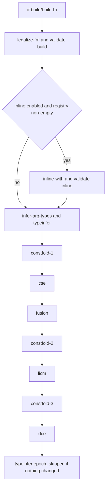

## What they are

IR optimization passes are a set of Lisp-implemented transformations that operate on [let-go](../entities/let-go.md)'s semantic intermediate representation (sem-IR). Each pass rewrites a Function in place. The passes include constant folding, common-subexpression elimination (CSE), loop-invariant code motion (LICM), dead-code elimination (DCE), type inference, loop fusion, and inlining. The pipeline runs before the IR is lowered to bytecode (`pkg/rt/core/ir/lower.lg`) or to Go (`pkg/rt/core/ir/lower_go.lg`).

Pass sources live in `pkg/rt/core/ir/passes/`. The `defpass` DSL is in `pkg/rt/core/ir/passes.lg`. All of these files are written in let-go (`.lg`). The bytecode compiler and VM are Go packages (`pkg/compiler/`, `pkg/vm/`). The Lisp passes are ports: their headers cite Go originals under `pkg/ir/passes/` (for example `constfold.go` and `cse.go`), and no `pkg/ir/passes/` directory exists in the tree at b82588292b.

## When they matter

The passes remove redundant work from the IR before lowering. `(+ 1 2)` folds to the constant `3` at compile time (constfold). A pure instruction, or a total-pure call, whose operands are loop-invariant is cloned into the loop's pre-header (licm). An effect-free instruction with no uses is removed (dce), including instructions left unused by earlier rewrites. The IR after these passes is what `lower.lg` and `lower_go.lg` consume. `lower.lg` emits the bytecode that runs on the [stack-vm](stack-vm.md). The IR is positional, indexed-RPN form, as described in [indexed-rpn-ir](indexed-rpn-ir.md) (`data.lg`, line 93).

## The pipeline

`optimize-fn` (`pkg/rt/core/ir/passes/pipeline.lg`, lines 140-152) runs in this order:

1. `legalize-fn!`, then `validate-fn!` with label `"build"`. `legalize-fn!` threads cross-block direct references through fresh block arguments. It touches only the references the validator would reject (`passes/legalize.lg`).
2. If `ir.passes.inline/*enable-inline*` is true and `ir.passes.inline/*inline-registry*` is non-empty, it runs `inline-with`, then validates `"inline"`. Both vars default to `false` and `{}` (`passes/inline.lg`, lines 20 and 25).
3. The default pass list (`default-pass-list`, lines 83-92), run by `run-pass-list` (lines 101-116). After each entry that has a label, `validate-fn!` runs with that label.

The default pass list, in order:

- typeinfra epoch: `infer-arg-types`, then `typeinfer`
- `constfold` (label `constfold-1`)
- `cse`
- `fusion`
- `constfold` (label `constfold-2`)
- `licm`
- `constfold` (label `constfold-3`)
- `dce`
- typeinfra epoch, with no validate step

A typeinfra epoch is skipped when no pass has replaced the Function's `:insts` or `:blocks` vector since the previous epoch. The check is an identity comparison (lines 95-116). In the default list this skips the trailing epoch whenever the middle passes changed nothing.



Constant folding runs three times because the passes before it can expose new folds. The pipeline header says CSE can expose folds and LICM can enable folds (`pipeline.lg`, lines 3-10). The list is fixed; it does not iterate to a fixed point.

The lambda-lifted sibling functions on the `:go` path use `uniform-pass-list` (lines 121-135), which is the default list without the typeinfra epochs. Their signatures stay untyped so that they lower through the boxed `vm.Value` ABI.

`compile-form*` calls `optimize-fn` on each single-arity and multi-arity defn it builds (`pipeline.lg`, around lines 805-841 and 849-878) and on deftype method bodies (line 358). Two gates exist in the default path: fusion (described below) and inlining (described below). No flag disables `constfold`, `cse`, `licm`, or `dce`.

## Pass DSL and structure

All passes use a unified macro called `(defpass ...)`, defined in `passes.lg`. The macro expands to a function `(NAME f)` that walks the Function with the `ir.zipper` cursor and returns `f`. The cursor visits the instructions of each block in block order and skips terminators (`zipper.lg` header). The macro provides three helpers:

- `(replace-refs! refs)`: rewrite an instruction's operand references
- `(replace-aux! aux)`: change auxiliary data (constants, jump targets, etc.)
- `(remove!)`: drop the current instruction from its block

A pass author writes only the pattern-matching and rewrite logic:

```clojure
(defpass my-optimization
  "One-sentence summary."
  [inst]                    ; inst is the current InstId
  (let [f  ir.passes/*current-fn*
        op (ir/op inst f)]
    (when (= op :some-op)
      ;; analyze inst, then mutate it via helpers above
      )))
```

Inside the body, three dynamic variables are bound for each visit: `*current-fn*` (the Function being transformed), `*current-inst*` (the InstId of this instruction), and `*current-zip*` (the zipper cursor).

## Key passes

### Constant folding

`passes/constfold.lg`. Three strategies are tried in order for each instruction; the first non-nil result is applied:

1. **Primitive fold**: both operands are constants. Binary ops (`add`, `sub`, `mul`, the bitwise ops, `quot`, float `div`, the comparisons, `eq`) and unary ops (`inc`, `dec`, `bit-not`) are evaluated at compile time. If evaluation throws, the instruction is left unchanged. Example: `(+ 3 5)` becomes `8`.
2. **Algebraic identities**: for example `(+ x 0)` and `(- x 0)` become `x`, `(* x 1)` becomes `x`, and `(* x 0)` becomes the constant `0`. The bitwise identities are handled the same way (`bit-or` and `bit-xor` with 0, `bit-and` with -1, and the shifts by 0).
3. **Commutative canonicalization**: for `add`, `mul`, `eq`, `bit-and`, `bit-or`, `bit-xor`, `unchecked-add`, and `unchecked-mul`, a constant left operand is swapped to the right. Example: `(+ 5 x)` becomes `(+ x 5)`.

### Dead-code elimination (DCE)

`passes/dce.lg`. An instruction is removable when `purity.lg`'s `effect-free-inst?` is true and it has no uses (`ir/uses-empty?`). One sweep removes the removable instructions. The pass repeats sweeps until a sweep removes nothing, because removing an instruction can leave its operands unused. Removal goes through `ir/remove-inst!`.

### Common-subexpression elimination (CSE)

`passes/cse.lg`. Within a single block, each instruction is keyed by `[op refs aux]`. An instruction is eligible when its op is in `purity.lg`'s `pure-ops` (a `:const` holding a collection literal is excluded), when it is a `:load-var` whose Var `mutability.lg` proves stable, or when it is a `:call` that `purity/pure-call?` proves pure (`cse-eligible?`, `cse.lg` lines 45-66). When an eligible instruction has the same key as an earlier one in the block, uses of the later instruction are redirected to the earlier one.

A `:set-var`, a `:def`, or a `:call` that is not a proven pure call clears the recorded `:load-var` entries, so a later identical load is not merged with an earlier one across that point (`var-root-barrier?`). CSE stays within block boundaries. Cross-block CSE needs dominance-based analysis and is deferred (`pipeline.lg`, lines 15-16).

### Loop-invariant code motion (LICM)

`passes/licm.lg`. LICM finds natural loops from back-edges, where a header block dominates the predecessor it is reached from. `back-edges` computes the dominator tree once with `ir.dominance`'s `dominators` and tests each pair with `dominates-idom?` (`licm.lg`, lines 45-56). The loop's pre-header must be a single non-loop predecessor of the header; a loop with zero or several such predecessors is skipped.

An instruction is hoisted when its op is in `purity.lg`'s `pure-ops`, or when it is a `:call` that `purity/total-pure-call?` accepts, and each of its refs is loop-invariant. A ref is loop-invariant when its defining block is outside the loop or the ref is already marked invariant. Marking iterates to a fixed point within one run, so an instruction whose operands are marked in an earlier round is hoisted in the same run (`collect-hoistable`, `licm.lg` lines 98-138). For a hoisted `:call`, a callee `:load-var` inside the loop is cloned into the pre-header as well; the original is removed once nothing uses it (`hoist-one!`, `drop-dead-callees!`, lines 140-180).

Hoisting does not move the instruction. `hoist-one!` clones it into the pre-header, redirects its uses to the clone with `ir/replace-all-uses!`, and removes the original with `ir/remove-inst!` (lines 168-171).

Hoisting can leave a use in the loop referring to a value defined in the pre-header. The file's header states that such cross-block direct references are cleaned up by threading block arguments (`licm.lg` header, lines 21-23).

The file's header (lines 25-31) lists limitations that the current code does not match:

- The "no cascading hoist" limitation is out of date. Dependent invariant instructions are hoisted in the same run, through the fixed-point marking described above.
- The "no OpCall" limitation is out of date. Total-pure calls are hoisted.

The one header limitation that still applies is that only one pre-header predecessor is handled per loop.

### Type inference

Type inference runs as a typeinfra epoch with two stages.

1. **`infer-arg-types`** (`passes/infer_arg_types.lg`) works backward from users. A `:load-arg` whose user is one of `add`, `sub`, `mul`, `inc`, `dec`, `lt`, `lte`, `gt`, or `gte` is given type `:int`, unless the parameter carries an explicit numeric hint from `:arg-types`. A hinted parameter keeps its hint; the pass only checks that the hint does not contradict the inferred type (`infer_arg_types.lg`, lines 117-134). The result is stored with `ir/set-type!`.
2. **`typeinfer`** (`passes/typeinfer.lg`) is a forward, CFG-aware worklist analysis. Load-args are seeded from the Function's `:arg-types`. Block parameters join the types on their incoming edge arguments. A `branch-if` refines its condition value by truthiness and falsiness. The lattice values include `:bottom`, `:unknown`, `:any`, `:nil`, `:true`, `:false`, `:bool`, `:string`, `:int`, `:float`, `:number`, constant types such as `[:const :int 0]`, and unions. The lattice operations are in `pkg/rt/core/ir/lattice.lg`.

Inferred types are written to the Function's `:types` side table. `ir/type-of` reads that table and falls back to the construction-time slot in the instruction vector (`data.lg`, lines 199-208). Lowering reads types through `ir/type-of`; for example, `lower_go.lg` uses it to choose Go representations.

### Loop fusion

`passes/fusion.lg`. Fusion finds chains in the same block in which `map`, `filter`, `remove`, or `keep` producers feed the collection argument of a `reduce` or `into` consumer, where the producer is the direct operand of the consumer (`consumer-heads`, `match-chain`, lines 29-70). For the outermost stages that pass a safety check (`qualifying-count`), it rewrites the consumer into transducer form with `ir/set-refs!` and `ir/set-aux!` (`fuse!`, lines 91-115). A `reduce` consumer becomes `transduce` with its step function wrapped in `completing`. An `into` consumer keeps its target and takes the transducer as its xform argument (the `into` branch, lines 104-107). Each stage in the chain is rewritten to its arity-1 transducer form (`rewrite-stages!`). It is gated by the dynamic var `*enable-fusion*`, which defaults to `true` (line 27). Binding it to `false` disables the pass.

### Inlining

`passes/inline.lg`. A callee is eligible when it does not rebind var roots, is not self-recursive, and has at most 40 instructions (`max-inline-insts`). `optimize-fn` splices an eligible callee only when `*enable-inline*` is `true` (default `false`) and `*inline-registry*` is non-empty. On the bytecode path, `compile-form*` runs `fold-outline!` before `optimize-fn`, and only when `*enable-inline*` is true and a registry is available (the registry is seeded from the cache when `*inline-registry*` is empty). `fold-outline!` outlines calls to fold-over-rest combinators into unrolled siblings and does not splice them. `optimize-fn` is called on the bytecode path in every case. Its splicing inliner does not fire there unless a caller binds `*inline-registry*`, because `compile-form*` does not bind it (`pipeline.lg`, lines 824-841).

## Supporting passes and analyses

These files are in `pkg/rt/core/ir/passes/` and are not part of `default-pass-list`:

- `legalize.lg`: runs first in `optimize-fn`; repairs cross-block direct references (see the pipeline section).
- `lambda_lift.lg`: on the `:go` path, hoists inner fn literals to top-level sibling functions. Used by `compile-form*` (`pipeline.lg`, lines 785-823).
- `cleanup.lg`: removes dead block parameters before execution-form indexing. Its header says it runs only on the execution-form path, not in the shared `optimize-fn` pipeline.
- `blockarg.lg`: classifies block arguments as trivial copies or merges and reports the counts. Its header says it changes nothing.
- `liveness.lg`: per-block backward dataflow over InstIds. It is analysis only. `pipeline.lg` (line 44) wires `ir.passes.liveness/reachable-nids` into `lower-go`.
- `mutability.lg`: var-root stability for `:load-var`. Used by CSE, LICM, fusion, and purity.
- `purity.lg`: effect analysis. `pure-ops` is the value-purity set used by CSE and LICM. `effect-free-inst?` is used by DCE. `:quot` is in `pure-ops` but not removable by DCE because it can trap on a zero divisor.
- `trace.lg`: the `trace-pass` macro records the live-instruction delta and wall-clock time for each pass call. `optimize-fn-traced` is a separate driver. It runs `typeinfer` (labeled `typeinfer-pre`), then loops over `constfold`, `cse`, `licm`, and `dce` for up to 16 iterations, stopping when the live-instruction count is unchanged. It runs `validate-fn!` after each pass and ends with a second `typeinfer` pass (`typeinfer-post`). It does not call `legalize-fn!`, `fusion`, `infer-arg-types`, or the second and third `constfold`. The header describes it as the same fixpoint loop as `optimize-fn`; the code differs from `optimize-fn`.
- `entry_frame.lg`: generates a Go `package main` entry file when `--entry-frame` is set. It is not an IR-to-IR pass.

Shared infrastructure outside `passes/`:

- `pkg/rt/core/ir/passes.lg`: the `defpass` macro and the `*current-*` vars.
- `pkg/rt/core/ir/data.lg`: IR data structure and accessors.
- `pkg/rt/core/ir/zipper.lg`: block-order cursor over instructions.
- `pkg/rt/core/ir/dominance.lg`: immediate dominators (`dominators`, `dominates?`) and reverse postorder. It has no postdominator computation.
- `pkg/rt/core/ir/lattice.lg`: type lattice operations used by `typeinfer`.
- `pkg/rt/core/ir/validate.lg`: `validate-fn!`, which runs at the labeled points in the pipeline.
- `pkg/rt/core/ir/dump.lg`: text dump of IR Functions.

## IR mutation invariants

All passes obey these rules:

- **Instruction identity is stable.** `ir/add-inst` assigns an InstId, and that ID keeps referring to the same slot. `ir/remove-inst!` removes the instruction from its block's `:insts` vector and sets its op to `:invalid`. It does not compact the instruction vector (`data.lg`, `remove-inst!`).
- **Each mutator affects the uses cache in a specific way.** `ir/replace-op!`, `ir/set-refs!`, `ir/add-inst`, `ir/add-inst-before!`, and `ir/clone-inst` call `invalidate-uses-state!`, and the next call to `ir/uses` rebuilds the def-to-use index. `ir/remove-inst!` patches the cache in place when it is not dirty. `ir/replace-all-uses!` moves the rewritten consumers' bits to the new definition when it is not dirty. `ir/set-aux!` and `ir/move-inst!` leave the cache unchanged (`data.lg`, `invalidate-uses-state!` at lines 385-389 and in the mutators at 409, 433, 452, 478-484, 612; `remove-inst!` at 519-550; `replace-all-uses!` at 721-769; `set-aux!` at 486-487; `move-inst!` at 615-623).
- **Source spans are merged when uses are redirected.** `ir/replace-all-uses!` takes the source infos of the old instruction and appends the ones not already present to the new instruction's source infos (`data.lg`, lines 735-740). In-place rewrites through `ir/replace-op!`, `ir/set-refs!`, and `ir/set-aux!` do not merge spans.
- **Mutations happen in place.** `defpass` returns the same Function atom, now transformed. `ir/set-type!` writes the `:types` side table directly and bypasses the atom (`data.lg`, `set-type!`).

## IR data layer

Passes interact with the IR through accessor functions defined in `data.lg` and exposed under the `ir/` namespace:

- **Inspection**: `ir/op`, `ir/refs`, `ir/aux`, `ir/block-of`, `ir/blocks`, `ir/block-insts`, `ir/block-params`, `ir/block-preds`, `ir/block-term`, `ir/type-of`, `ir/source-infos`
- **Mutation**: `ir/replace-op!`, `ir/set-refs!`, `ir/set-aux!`, `ir/set-type!`, `ir/replace-all-uses!`, `ir/clone-inst`, `ir/move-inst!`, `ir/remove-inst!`
- **Uses index**: `ir/uses`, `ir/uses-empty?`, `ir/invalidate-uses!`

The Function is a Lisp atom holding a map with `:name`, `:arity`, `:variadic?`, `:arg-types`, `:entry`, `:consts`, `:insts`, `:blocks`, `:uses-cache`, `:uses-dirty?`, and the side tables `:types` and `:source-info` (`data.lg`, header comment and `new-fn`). Each instruction is a positional vector read with `nth`, laid out as `[op refs aux block source-infos type]` (`data.lg`, line 162). Source infos and inferred types live in the side tables. Slot 4 (source-infos) is superseded by the `:source-info` side table and is not read. Slot 5 holds the construction-time type, which `ir/type-of` reads as a fallback when the `:types` table has no entry (`data.lg`, lines 165-168 and 199-208). Each block is a map with `:id`, `:params`, `:insts`, `:preds`, and `:term`.

## Design notes

The design spec named in the frontmatter (`docs/superpowers/specs/2026-05-22-sem-ir-passes-design.md`) is not in the upstream tree at b82588292b, so the statements below rest on the code and comments at that commit, not on the spec.

- **Block arguments are first-class.** Blocks carry `:params`, and branch targets carry `:args` (`data.lg` header comment). `pipeline.lg` (lines 12-13) says build emits block-argument parameters for cross-block captures. `legalize.lg` repairs the shapes that build-time threading still misses, such as the `:try` lowering.
- **Passes are written in let-go.** Every file under `passes/` and the pass DSL are `.lg` files.
- **Self-hosting is the stated direction.** `docs/contribution-policy.md`, section 2, describes the longer arc as let-go implemented in let-go (compiler, reader, runtime ops, eventually the VM dispatch loop), lowered to Go for the shipped binary. That section does not name the IR passes or the lowering stages.

# Citations

Citations are to `nooga/let-go` at b82588292b, 2026-10-20.

**Resource**: [pkg/rt/core/ir/passes/pipeline.lg](https://github.com/nooga/let-go/blob/main/pkg/rt/core/ir/passes/pipeline.lg) — the pipeline driver, pass list, and compile-form integration.

**Passes** (each in `pkg/rt/core/ir/passes/`):
- `constfold.lg` — constant folding, algebraic identities, commutative canonicalization
- `cse.lg` — per-block common-subexpression elimination
- `dce.lg` — dead-code elimination (iterative)
- `licm.lg` — loop-invariant code motion with dominance
- `infer_arg_types.lg` — backward argument-type constraints
- `typeinfer.lg` — forward type inference
- `fusion.lg` — loop fusion of reduce over map/filter/remove/keep
- `inline.lg` — inlining of small, non-recursive callees
- `legalize.lg` — cross-block reference repair
- `lambda_lift.lg` — hoisting of inner fn literals (`:go` path)
- `cleanup.lg` — dead block-parameter removal (execution-form path)
- `blockarg.lg` — block-argument classification census
- `liveness.lg` — per-block liveness analysis
- `mutability.lg` — var-root stability analysis
- `purity.lg` — effect analysis (used by CSE, DCE, LICM, fusion)
- `trace.lg` — per-pass tracing and the `optimize-fn-traced` driver
- `entry_frame.lg` — Go entry-file generation for AOT builds

**Infrastructure** (`pkg/rt/core/ir/` unless noted):
- `passes.lg` — `defpass` macro and pass-author helpers
- `data.lg` — IR data structure and accessor functions
- `zipper.lg` — block-order cursor over instructions
- `dominance.lg` — immediate dominators
- `lattice.lg` — type lattice operations
- `validate.lg` — `validate-fn!` checks run at labeled pipeline points
- `dump.lg` — debugging dump format
- `docs/contribution-policy.md` (repo root) — self-hosting direction

**Design doc**: `docs/superpowers/specs/2026-05-22-sem-ir-passes-design.md` (local, 2026-07-02) — not present in the upstream tree at b82588292b. Its contents are not verified by this page.
