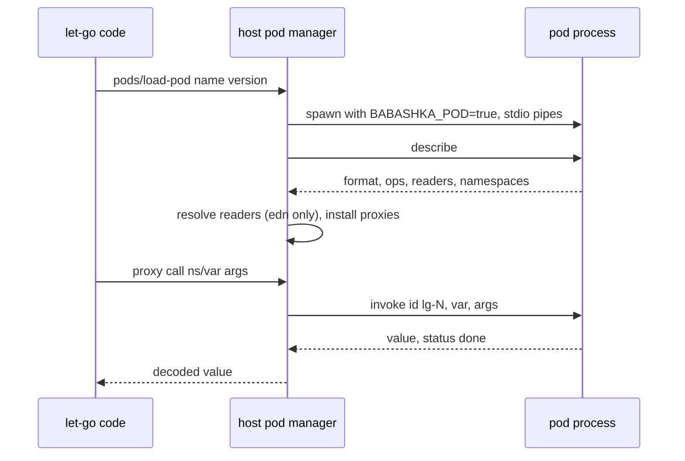

# Pods

let-go loads **Babashka pods** — external processes that expose Clojure functions over a simple RPC protocol on their stdin and stdout. Pods open the whole pod ecosystem (SQLite, AWS, Docker, file watching, and more) without requiring JVM interop or shipping as a monolithic binary.

## What are pods?

A pod is an external process speaking the Babashka pods protocol: messages exchanged over the pod's stdio, with a request/response model. Messages are bencode-encoded maps (`pkg/rt/pods.go`, `bencode.NewDecoder(stdout)`). The host (let-go) spawns a pod, asks it to describe its exported namespaces and vars, and then invokes those vars on demand. The payloads inside a message (arguments and values) are strings in the pod's declared format: `json` (the default when `describe` names none), `edn`, or `transit+json` (`pkg/rt/pods.go`, `Pod.encodeArgs` and `Pod.decodePayload`).

## Protocol

The protocol is Babashka's. Invoke requests and their replies carry an `id`; the host allocates ids of the form `lg-N` (`pkg/rt/pods.go`, `nextID`). The `describe` request has no `id`, and its reply is read directly before the router starts (`Pod.describe`, `recvRaw`); the router drops any routed message with an empty `id` (`startRouter`).

- **`describe` operation** → the pod replies with `format`, `ops`, `readers`, and `namespaces`. Each namespace lists its vars with optional `code` (client-side code), `meta`, and `arg-meta`. `pkg/rt/pods.go`, `Pod.describe`.
- **`invoke` operation** → the host sends `op`, `id`, `var` (a qualified name such as `"ns/name"`), and `args` (an encoded payload). The reply carries `value` (an encoded payload), or `ex-message` and `ex-data` for an error. A reply with `status` containing `done` ends the call.
- **`shutdown` operation** → sent only when the describe reply's `ops` lists it. `Pod.Shutdown`.
- **`out` and `err`** keys on any message are written to let-go's `*out*` and `*err*` (`pkg/rt/pods.go`, `startRouter`).

The router goroutine dispatches each reply to the channel registered under its `id`. When the pod's stdout closes or a message fails to decode, the router closes every pending channel (`startRouter`).

The design doc ([2]) proposed newline-delimited EDN messages with `:op`/`:id` keys and a `:shutdown` op. That is not the shipped wire format: the transport is bencode, and only the payload is EDN when the pod says `format` is `edn`.

## Loading pods

```clojure
; Load by executable name (looked up on PATH) or by name and version
(pods/load-pod 'org.babashka/go-sqlite3 "0.3.13")

; Proxy namespaces come from the pod's describe reply
(pod.babashka.go-sqlite3/query "app.db" ["select * from users"])

; Synchronous invoke by pod id and qualified var symbol
(pods/invoke pod-id 'pod.test/tagged [])
```

`pods/load-pod` (also reachable as `babashka.pods/load-pod`) takes a string or symbol name and an optional version string. With no version, the name is resolved on `PATH` (`resolvePodBinary`). With a version, the binary is found in the Babashka pod cache, `$BABASHKA_PODS_DIR` or `~/.babashka/pods`, under `repository/<name>/<version>/<os>/<arch>` (`findCachedPod`). It returns the name of the pod's first namespace as a string. The guide ([5]) notes that let-go shares `~/.babashka/pods/` with `bb`, so pods installed by babashka can be used from `lg`.



## Data mapping

The table below describes the EDN mapping, as the design doc ([2]) states it. It has not been re-checked against the reader at b82588292b.

| EDN type | let-go type |
|----------|-------------|
| `nil`, booleans, ints, strings, chars | scalars (identity mapping) |
| Keywords, symbols | keywords, symbols |
| Vectors, lists | `PersistentVector`, `List` |
| Maps (string/keyword/symbol keys) | `PersistentHashMap` |
| Sets | `PersistentHashSet` |
| Errors | let-go exceptions with pod-provided message and optional data |

Decoding depends on the pod's format:

- **`edn`**: every reply is read with `edn/read-string` and the `:readers` map from the describe reply, through the on-demand `pods.edn` namespace (`pkg/rt/core/pods/edn.lg`). `-read-edn` is reached from `pkg/rt/pods.go` `decodePayload`; `-resolve-readers` is reached from `resolveReaders`, which `load-pod` calls before `createProxyNamespaces`. The pod's custom tags are decoded, and `*data-readers*` is not used. A payload that does not read is printed on `*err*` as `Cannot read EDN:  "<payload>"` (two spaces after the colon, the payload quoted as `pr-str` prints it) and then surfaces as an error ([6]). The fixture `test/fixtures/pods/edn_readers_test.lg` pins this behavior.
- **`json`** and **`transit+json`**: decoded by `JSONDecodeValue` and `TransitDecodeValue` (`pkg/rt/transit.go`). Under the `lg_no_json` build tag these are stubs that return an error (`pkg/rt/json_stub.go`), so a pod in either format cannot be used in such a build.

Readers resolve before the pod's client code runs. A reader symbol names an existing var, or a var interned now and bound when the client code defines it (`pkg/rt/core/pods/edn.lg`, `-reader-var`). Commit 9981aa044 ([#987](https://github.com/nooga/let-go/pull/987)) added this path.

## Host architecture

**Pod process** (`pkg/rt/pods.go`, `startPod`):
- Spawns the binary with stdin, stdout, and stderr pipes and `BABASHKA_POD=true` in its environment. A goroutine copies the pod's stderr to `*err*`.
- Runs the describe handshake, then starts the background router.
- Registers the pod by its first namespace name (`registerPod`, `podRegistry`).
- `ShutdownAllPods` is deferred by the `lg` and `lg-runtime` entry points (`pkg/cli/cli.go`, `pkg/cli/compile.go`, `cmd/lg-runtime/main.go`), and by the generated entry frame (`pkg/rt/core/ir/passes/entry_frame.lg`).

**Calls**:
- `Pod.Invoke` (synchronous) sends an `invoke` and reads replies until the channel closes. It has no timeout and no cancellation. If the pod exits mid-call, the router closes the pending channel on a decode failure, and `Invoke` then returns `nil` with no error. This is the code path as read; no test pins it at b82588292b (`Invoke`, `startRouter`).
- `Pod.InvokeAsync` registers a streaming channel that stays open after `done`. It ends on an error reply, a payload that does not decode, or `done` (`InvokeAsync`, `endStream`). `pods/invoke` with `{:handlers {:success :error :done}}` runs this path. An error goes to `:error` and suppresses `:done` (`installPodsNS`).

**Proxy namespace** (`createProxyNamespaces`, `makePodProxy`):
- For each described var with no `code`, a let-go `Var` is defined in the pod's namespace. Calling it runs `Pod.Invoke` with the qualified name.
- A var that has `code` is client-side code. It is evaluated in the pod's namespace with `evalInNS`. A failure is written to `*err*` and does not stop loading.
- Errors from a synchronous call are thrown as an exception whose map has `:message` and, when present, `:data`. Errors on the async path arrive as a map with `:error` and `:data`.

**Shutdown** (`Pod.Shutdown`): sends `shutdown` if the pod advertised it, then waits for the process to exit. Otherwise it kills the process (commit 768ad2913).

**WASM**: in `js && wasm` builds `pkg/rt/pods.go` is excluded, and `pkg/rt/pods_wasm.go` defines `installPodsNS` and `ShutdownAllPods` as no-ops. No `pods` namespace is registered, so pods are unavailable there.

## Ergonomics

The shipped host API is the `pods` namespace, also aliased as `babashka.pods`, with two functions ([1]; `installPodsNS`):

- `(pods/load-pod name)` and `(pods/load-pod name version)`: load a pod and return its first namespace name.
- `(pods/invoke pod-id var-sym args)` and `(pods/invoke pod-id var-sym args {:handlers {...}})`: synchronous or handler-based invoke.

`pods/load`, `pods/unload`, `pods/list`, and the `& {:as opts}` alias option described in the design doc ([2]) are not defined at b82588292b. Pods are not unloaded individually; they stop when the runtime exits.

CLI helpers (still planned; no `pods` subcommand exists in `cmd/`):

- `lg pods describe <path>` — prints the pod's descriptor.
- `lg pods run <path> -- <args>` — quick test runner.

## Security and resource limits

Pods run as external processes, so they inherit OS-level process isolation. A pod's failure does not crash the host process. By the code path, a call waiting on a dead pod returns `nil` without an error (see Host architecture).

Not implemented at b82588292b, though described in the design doc ([2]):

- Allowlist or denylist of pod executables. Any binary found on `PATH` or in the pod cache can be started.
- Per-call timeouts, memory limits, CPU limits, or a cap on concurrent calls. `Invoke` waits without a deadline.
- Cancellation with SIGTERM.

For stricter sandboxing, pods can be run in containers (Docker, VM, etc.). That remains a recommendation.

## Why pods

- **Ecosystem reuse**: Babashka's growing pod collection is instantly available.
- **No JVM dependency**: let-go stays a lean single binary; interop code runs in a separate process.
- **Safe isolation**: each pod is a process boundary, so a crashing pod does not take down let-go, though by the code path its pending calls return `nil`.
- **Portable**: bencode over stdio means pods can be written in any language that speaks the Babashka protocol.

## Planned extensions

- **TCP transport** for remote pods. The shipped transport is stdio only.
- **Chunked I/O for large payloads.** Streaming invoke is shipped (`InvokeAsync`). The `transit+json` payload format is also shipped, but a pod chooses its format in `describe`, and the host does not choose it.
- **Retry logic and reconnection** for resilient long-running pods. A dead pod is not restarted.

# Citations

[1] **pkg/rt/pods.go**: Pod manager, stdio transport, bencode request/response routing, the `pods` namespace  
https://github.com/nooga/let-go/blob/main/pkg/rt/pods.go

[2] **docs/design/pods.md**: Detailed design, protocol spec, implementation plan. The protocol section predates the bencode transport.  
https://github.com/nooga/let-go/blob/main/docs/design/pods.md

[3] **Babashka pods**: Protocol documentation and existing pod ecosystem  
https://github.com/babashka/pods

[4] **let-go** (this wiki)  
[../entities/let-go.md](../entities/let-go.md)

[5] **docs/guide/pods.md**: User guide, pod cache sharing with `bb`  
https://github.com/nooga/let-go/blob/main/docs/guide/pods.md

[6] **pkg/rt/core/pods/edn.lg**: reader policy for EDN replies (`pods.edn` namespace), added by [#987](https://github.com/nooga/let-go/pull/987). **pkg/rt/pods_edn.go** holds the EDN argument encoder, created under [#973](https://github.com/nooga/let-go/pull/973) and changed by #987.  
https://github.com/nooga/let-go/blob/main/pkg/rt/core/pods/edn.lg

---

See also: [go-interop](go-interop.md), [stack-vm](stack-vm.md)
