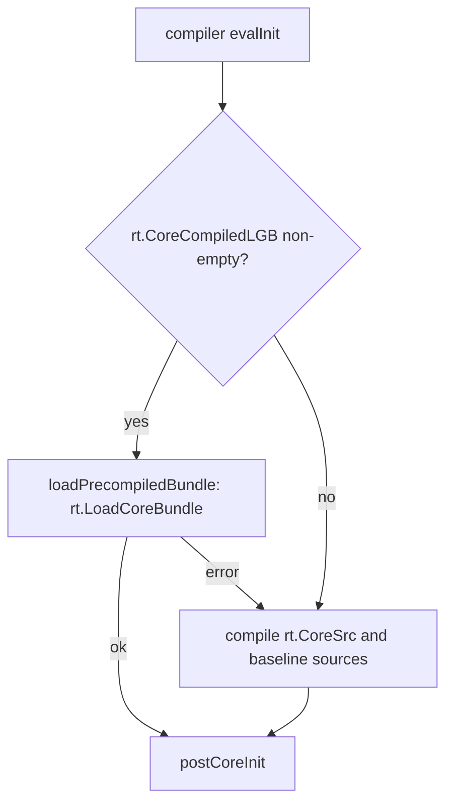

# Runtime Image and Stdlib Cache

Let-go's precompiled startup path today is a **bytecode bundle** of the core library. It is written in the LGB format, embedded in the `lg` binary, and decoded at boot instead of compiling `core.lg` from source. The snapshot-style **runtime image** (`image/save`, `stdlib.img`, a `HostRegistry`) is designed in the design doc [7], whose status is `planning` and whose implementation checklist has no items checked. This page describes what the tree implements and marks the parts that exist only as design.

Measured startup, as recorded in the repo: `benchmark/results.md` lists let-go at 11.1 ms ± 0.8 ms wall-clock [8]. `docs/perf/size-boot-audit/README.md` reports about 1 ms for in-process bundle decode and eval, against about 13 ms for compiling core from source [9]. That README's own wall-clock measurement of `lg -e nil` (about 7-10 ms, measured 2026-07-17; the README's 2026-09-17 re-run covers only its compute section) includes a fixed OS-spawn and Go-runtime floor of about 5 ms [9]. `benchmark/results.md` has no date and measures a different driver (a fixture run with namespace load), so the 5 ms floor is not stated for the 11.1 ms figure in that file.

## Boot Path

`evalInit` tries the precompiled bundle first and falls through to source compilation only when that returns an error [3]. The `CoreSrc` string is the embedded `core/core.lg` [1][2].

## Implemented: Embedded Core Bundle

- **Build.** `pkg/rt/core_embed.go` carries `//go:generate go run -tags bootstrap ../../cmd/lgbgen core_compiled.lgb` and embeds the result as `rt.CoreCompiledLGB` [10]. `cmd/lgbgen` compiles core and the embedded namespaces into that bundle, except namespaces whose source starts with `;; lgbgen:skip` and build-time tool namespaces: `ir.*`, `lg.compiler.*`, and `lg.commands.*` (`isBundleSkippedTool`). Those load from source on demand [11].
- **Load.** `rt.LoadCoreBundle` decodes the bundle, replays core's main chunk, runs the lg baseline namespace chunk for `let-go.core` (`let-go.types` is Go-defined, has no chunk, and is skipped) [16], runs hybrid namespace chunks eagerly when `EagerHybrids` is set, and marks every other namespace as needing load so that `require` loads it on demand. It saves and restores `*ns*` around the replay [16].
- **Entry points.** `rt.LoadCore` (`pkg/rt/boot.go`) and `rt.BootCore` (`pkg/rt/bootcore.go`) use the same loader. `BootCore` is for programs that link `pkg/rt` and `pkg/vm` without the compiler [16].
- **Empty bundle.** A `-tags bootstrap` build embeds an empty bundle through `pkg/rt/core_embed_bootstrap.go` [21], and `LoadCoreBundle` then returns an error [16]. `pkg/rt/core_embed.go` is built only without the `bootstrap` tag [10].

## Implemented: User Bundles

- `lg -c file.lg` compiles a source file to an `.lgb` file [12].
- `lg file.lgb` runs an `.lgb` file; the script dispatcher routes the `.lgb` extension to the bundle loader [12].
- `lg -b file.lg out` writes a standalone executable: a copy of the `lg` binary with the LGB payload, an optional resource archive, and a trailer appended [12][13]. The payload's namespace chunks are the namespaces loaded during compilation plus the main namespace [12].
- `-z` DEFLATE-compresses the bundle body. `-strip` moves source maps and local-variable tables into a `.debug` companion [12]. The split is done by `bytecode.SplitDebug`, which returns the stripped bundle and the companion [22].

## Bytecode Format (LGB)

The format details are in [LGB bytecode format](lgb-bytecode-format.md). The parts that matter for images:

**Header** [5][14]:

- Magic `LGB` followed by byte `0x01` [14].
- `uint16` format version, little-endian. The decoder accepts versions 1, 2, and the current `FormatVersion`, which is 3 [14][15]. A function constant is a `vm.Func` [4].
- `uint16` flags.
- When the capabilities flag is set, a `uint32` capability mask. When the opcode-set capability is set, a varint opcode count and a `uint64` opcode-set signature [5].

**Body**, in this order [5]:

1. String table.
2. Namespace ranges (optional, under `FlagNSRanges`).
3. Chunks: for each `CodeChunk`, `MaxStack`, the code as `int32` words, and source-map entries.
4. Constant pool: a count, an optional `ConstsBase` offset, then tagged values.
5. Namespace table: namespace name → chunk index.
6. Local-variable tables (optional, under `FlagLocalVars`).

**Constant values.** The encoder writes nil, booleans, ints, floats, strings, keywords, symbols, chars, big ints, void, UUIDs, instants, funcs, var references, lists, vectors, maps, sets, record types and records, regexes, named deftype instances, and atoms. An atom is written as its current value [5]. A function constant (`vm.Func` [4]) is written as its chunk index, arity, variadic flag, and name [5]. An instance of a reify type has no name that a decoder can resolve, so it fails with `unsupported value type for serialization` [5]. Any other value type that the encoder has no case for also fails with that error [5].

**Not encoded.** There is no encoding for `Closure`, `NativeFn`, or `Boxed` values. The encoder has no case for them [5]. Instants are encoded, so time values are not excluded [5].

**Trailer.** The LGB body has no checksum or signature. The bundle trailer that `lg -b` appends stores the LGB length, the optional resource archive length, an optional store id, and one of the magics `LGBX`, `LGB2`, or `LGB3` [13].

**Load-time checks** [15]:

- Magic, version, and flags are checked.
- The opcode-set signature must match the runtime's. On mismatch the decoder uses a registered migration if one exists, and otherwise returns `opcode set mismatch ... recompile the bundle with a matching lg` [15].
- String and chunk indices are range-checked [15].
- The declared uncompressed body size is capped [15].

## Var References and Natives

The bundle contains no extern placeholders. A var is written as a `(namespace, name)` reference [5]. On decode, `rt.LGBVarResolver` looks the name up in the namespace and, if it is absent, interns a stub with `DefStub` [6][17]. Native functions are installed by Go package initializers before the bundle is replayed [16]. A name that is not defined stays a stub; the load does not fail on it [6][17].

## Design Only: Runtime Image

The following exist only in the design doc [7] and the Phase 5 plan [18]. None of the names below appears in `pkg`, `cmd`, or the `lg` command set at this commit:

- `image/save` and `image/load`, and `SaveImage` / `LoadImage` with a `HostRegistry`.
- `stdlib.img`, built at build time and checked at boot.
- Extern placeholders resolved against a `HostRegistry`, with arity checks at load.
- A header carrying a runtime version and a content hash of stdlib sources, and a loader that regenerates on mismatch. The implemented header already carries the format version, `FormatVersion` = 3 [14][15].
- Layered images: a base stdlib image plus app layers with conflict checks.
- Trailer checksum and optional signature.
- Persistent-collection encodings (BPTR/HAMT) for deterministic output.

The Phase 5 acceptance target is cold start with a stdlib image under 50 ms [18]. The measured numbers above are for the embedded bundle, not for `stdlib.img`.

The constant-pool layering that exists in the format is separate from these app layers. A module may be encoded against a parent pool through `ConstsBase`, and the REPL compiles each input into a child pool of the session pool [5][19].

## Why It Matters

- **Startup.** Boot decodes the embedded core bundle instead of compiling `core.lg` [3][16]. The timings above are the recorded measurements.
- **Standalone programs.** `lg -b` produces one executable that carries the program's namespace chunks [12][13].
- **Compatibility.** A bundle is tied to the opcode set it was compiled with. A bundle from a different opcode set is rejected unless a migration is registered [15]. The format carries no content hash of sources, so a bundle is not checked against the source it came from.
- **Build time.** The parallel-lowering design doc [20] states that `lgbgen --target=go` lowering is "the slowest step in the bootstrap (~3 min)". That is an estimate in that document, not a measurement recorded here, and it applies to the Go-lowering target. The repo does not state how long the `.lgb` bundle build takes.

## Security Considerations

- The LGB loader validates the magic, version, flags, opcode-set signature, index ranges, and uncompressed size [15].
- The loader does not verify a content hash or a signature, because the format has neither [5][13].
- Bundle loading runs bytecode. `LoadCoreBundle` runs the core and baseline chunks during load [16].
- The design doc treats images as untrusted input and plans section validation, content-hash checks, optional signature verification, and resolution of externs only through a host registry [7]. None of the planned checks is implemented.

# Citations

[1] **pkg/rt/core/core.lg**: standard library source, embedded at `pkg/rt/lang.go` (see [2])
https://github.com/nooga/let-go/blob/b82588292b58ac70908895cc6d9b05e68401e261/pkg/rt/core/core.lg

[2] **pkg/rt/lang.go**: `CoreSrc` embed of `core/core.lg` (lines 763-764)
https://github.com/nooga/let-go/blob/b82588292b58ac70908895cc6d9b05e68401e261/pkg/rt/lang.go

[3] **pkg/compiler/eval.go**: `evalInit` precompiled-bundle branch and source fallback (lines 203-271); `loadPrecompiledBundle` (lines 273-318)
https://github.com/nooga/let-go/blob/b82588292b58ac70908895cc6d9b05e68401e261/pkg/compiler/eval.go

[4] **pkg/vm/func.go**: `Func` type (line 27)
https://github.com/nooga/let-go/blob/b82588292b58ac70908895cc6d9b05e68401e261/pkg/vm/func.go

[5] **pkg/bytecode/encoder.go**: `writeHeader` (534), `writeBody` (132), `writeChunks` (593), `writeConsts` (636), `writeValue` (654, default case returns the unsupported-type error)
https://github.com/nooga/let-go/blob/b82588292b58ac70908895cc6d9b05e68401e261/pkg/bytecode/encoder.go

[6] **pkg/rt/run.go**: `LGBVarResolver` (lines 33-41), the single var-ref resolver for `.lgb` decode
https://github.com/nooga/let-go/blob/b82588292b58ac70908895cc6d9b05e68401e261/pkg/rt/run.go

[7] **docs/design/runtime-image-and-stdlib-cache.md**: design, `status: planning`, checklist unchecked
https://github.com/nooga/let-go/blob/b82588292b58ac70908895cc6d9b05e68401e261/docs/design/runtime-image-and-stdlib-cache.md

[8] **benchmark/results.md**: startup table (let-go 11.1 ms ± 0.8 ms)
https://github.com/nooga/let-go/blob/b82588292b58ac70908895cc6d9b05e68401e261/benchmark/results.md

[9] **docs/perf/size-boot-audit/README.md**: "Boot time" section, in-process decode and source-compile figures
https://github.com/nooga/let-go/blob/b82588292b58ac70908895cc6d9b05e68401e261/docs/perf/size-boot-audit/README.md

[10] **pkg/rt/core_embed.go**: `go:generate` line and `go:embed core_compiled.lgb` into `CoreCompiledLGB`
https://github.com/nooga/let-go/blob/b82588292b58ac70908895cc6d9b05e68401e261/pkg/rt/core_embed.go

[11] **cmd/lgbgen/main.go**: bundle generator for `core_compiled.lgb`; `discoverEmbeddedNS` (`lgbgen:skip` directive) and `isBundleSkippedTool` (ir.*, lg.compiler.*, lg.commands.*, bundle only)
https://github.com/nooga/let-go/blob/b82588292b58ac70908895cc6d9b05e68401e261/cmd/lgbgen/main.go

[12] **pkg/cli/cli.go**: flags `-c`, `-b`, `-z`, `-strip` (lines 431-437); `bundleBinary` (line 145); `.lgb` dispatch in `runScript` (line 137); bundle payload chunk selection (lines 170-190)
https://github.com/nooga/let-go/blob/b82588292b58ac70908895cc6d9b05e68401e261/pkg/cli/cli.go

[13] **pkg/bundle/bundle.go**: bundle magics (lines 34-36); `AppendTrailer` (line 266)
https://github.com/nooga/let-go/blob/b82588292b58ac70908895cc6d9b05e68401e261/pkg/bundle/bundle.go

[14] **pkg/bytecode/tags.go**: `Magic` (line 4), `FormatVersion` (line 9)
https://github.com/nooga/let-go/blob/b82588292b58ac70908895cc6d9b05e68401e261/pkg/bytecode/tags.go

[15] **pkg/bytecode/decoder.go**: version dispatch (lines 86-112), `readHeader` (line 676), `resolveOpcodeSet` (line 188), uncompressed size cap (line 251), index range checks (lines 736, 1221)
https://github.com/nooga/let-go/blob/b82588292b58ac70908895cc6d9b05e68401e261/pkg/bytecode/decoder.go

[16] **pkg/rt/coreload.go**: `LoadCoreBundle` (line 71), baseline loop skipping Go-only `let-go.types` (lines 137-147); **pkg/rt/bootcore.go**: `BootCore` (line 34); **pkg/rt/boot.go**: `LoadCore` (line 34)
https://github.com/nooga/let-go/blob/b82588292b58ac70908895cc6d9b05e68401e261/pkg/rt/coreload.go

[17] **pkg/vm/namespace.go**: `DefStub` (line 408)
https://github.com/nooga/let-go/blob/b82588292b58ac70908895cc6d9b05e68401e261/pkg/vm/namespace.go

[18] **docs/master-plan.md**: Phase 5, "Runtime images and precompiled stdlib", scope and acceptance
https://github.com/nooga/let-go/blob/b82588292b58ac70908895cc6d9b05e68401e261/docs/master-plan.md

[19] **pkg/cli/repl.go**: each REPL input compiles into a child const pool (line 129); `ConstsBase` in `pkg/bytecode/module.go` (line 17)
https://github.com/nooga/let-go/blob/b82588292b58ac70908895cc6d9b05e68401e261/pkg/cli/repl.go

[20] **docs/design/parallel-lowering-and-type-cache.md**: "slowest step in the bootstrap (~3 min)" for `lgbgen --target=go` (lines 19-20)
https://github.com/nooga/let-go/blob/b82588292b58ac70908895cc6d9b05e68401e261/docs/design/parallel-lowering-and-type-cache.md

[21] **pkg/rt/core_embed_bootstrap.go**: `//go:build bootstrap`; `var CoreCompiledLGB []byte` (empty bundle under `-tags bootstrap`)
https://github.com/nooga/let-go/blob/b82588292b58ac70908895cc6d9b05e68401e261/pkg/rt/core_embed_bootstrap.go

[22] **pkg/bytecode/debug_companion.go**: `SplitDebug` (line 49), removes source maps and local-variable tables and returns the companion; called from `pkg/cli/cli.go` (line 196, line 315)
https://github.com/nooga/let-go/blob/b82588292b58ac70908895cc6d9b05e68401e261/pkg/bytecode/debug_companion.go

---

See also: [Bytecode Compiler](bytecode-compiler.md), [LGB bytecode format](lgb-bytecode-format.md), [lg compile](lg-compile.md), [Compile paths](compile-paths.md), [Stack VM](stack-vm.md), [IR Pipeline](ir-pipeline.md)
