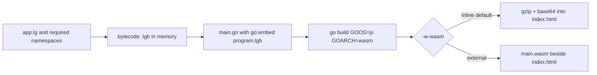

# WASM Compilation

let-go compiles programs to WebAssembly web pages with `lg -w`, from the same source that builds a native binary. `lg -w site app.lg` writes `site/index.html` and `site/coi-serviceworker.js`. With the default `-w-wasm inline`, the WASM module is inside `index.html`, gzipped and base64-encoded. At b82588292b a build of a small app produced an 8.4 MB `index.html`; the upstream usage guide says ~6MB. With `-w-wasm external`, the raw module is written as `main.wasm` beside `index.html`.

## Build Process



1. **Bytecode compilation.** `buildWasm` in `pkg/cli/wasm.go` compiles the input file with `ctx.CompileMultiple`. The main namespace and any namespaces it requires are encoded into one in-memory `.lgb` module: `bytecode.EncodeBundleOrdered` when namespaces were loaded, `bytecode.EncodeCompilation` otherwise. This is the standard [bytecode compiler](bytecode-compiler.md) pipeline. `-strip` moves source maps and local-variable tables into a debug companion written beside the output.

2. **Generated Go program.** The `.lgb` is written to a temporary build directory as `program.lgb`. `RenderMain` in `pkg/rt/wasm/rendermain.go` writes a `main.go` that embeds it with `go:embed`. The bytecode therefore becomes part of the WASM binary; it is not a separate payload in the HTML. The generated `go.mod` requires let-go as follows (`writeGoModule` in `pkg/cli/wasm.go`, `gomod.Generate` in `pkg/gomod/gomod.go`). A host built through a let-go `replace` directive reproduces that directive. Otherwise, a released lg (version starting with a digit) pins its own `github.com/nooga/let-go@v<version>`, and `LETGO_SRC` is ignored. A dev build uses `LETGO_SRC`, or the enclosing let-go checkout, as the replace target. `-resource-paths` still applies to the `-w` compile process, since `buildResourcePaths` installs the FS resource provider before the mode dispatch in `pkg/cli/cli.go`. It does not reach the output: `buildWasm` collects no resource archive, so io/resource in the page sees none of those roots. Resource archives are collected by `bundleBinary` in `pkg/cli/cli.go` for `lg -b`, which appends them with the bundle trailer; `pkg/cli/wasm.go` does not import `pkg/bundle`.

3. **Go build.** `go build` runs with `GOOS=js GOARCH=wasm`, `GOCACHE` and `GOTMPDIR` pointed into the build directory. The `go` binary comes from `gomod.GoToolPath()`: the `bin/go` under the GOROOT the lg binary was built with, if that file still exists, otherwise `go` on `PATH` (`pkg/gomod/gomod.go`). With `LETGO_USE_TINYGO=1` the build runs `tinygo build -target=wasm` instead. `-w-module` cannot be combined with TinyGo.

4. **Output.** `AssembleHTML` in `pkg/rt/wasm/embed.go` fills the page template with `wasm_exec.js`, the host glue, and the payload.
   - Inline mode gzips the module at best compression and base64-encodes it into `index.html`.
   - External mode writes an empty inline payload and `main.wasm`. In worker mode the main thread compiles `main.wasm` with `WebAssembly.compileStreaming` (falling back to `compile` on an ArrayBuffer) and posts the Module to the worker, which instantiates it. In main-thread mode the loader uses `WebAssembly.instantiateStreaming`, with an `arrayBuffer` fallback (`pkg/rt/wasm/lg-host-core.js`).
   - `coi-serviceworker.js` is written in both modes (`pkg/cli/wasm.go`, the `coiServiceWorkerJS` string and its write to the output directory).
   - Deploy `index.html` and `coi-serviceworker.js` together (for example to GitHub Pages). The service worker supplies the COOP/COEP headers that GitHub Pages needs for SharedArrayBuffer ([docs/guide/usage.md](https://github.com/nooga/let-go/blob/main/docs/guide/usage.md), "WASM web apps").
   - The default `-w-shell xterm` page loads xterm.js and its CSS from cdn.jsdelivr.net (`@xterm/xterm@5.5.0`, `@xterm/addon-fit@0.10.0`). The page therefore needs network access to render its terminal.

## Output Options

| Flag | Effect |
| --- | --- |
| `-w-wasm inline` (default) or `external` | Inline the gzip-base64 module into `index.html`, or write it as `main.wasm` fetched at load. |
| `-w-shell xterm` (default), `none`, or a template path | `xterm` adds the xterm.js shell. `none` emits the core glue only, and the client binds its own shell through `window.LetGoHost`. A template path must contain `__LG_HOST_JS_BODY_PLACEHOLDER__` exactly once. |
| `-w-host-eval` | Adds `LetGoHost.eval(code)` and `LetGoHost.request(req, onFrame)`, and keeps the program's runtime parked so they stay callable. |
| `-w-module <dir>` | Builds inside a caller's Go module, using its `go.mod` and `go.sum` with `-mod=readonly`. `-import` (repeatable, requires `-w-module`) blank-imports a Go package so its `init()` registers its namespaces; the module's `go.mod` must already require that package. |
| `-strip` | Writes source maps and local-variable tables to a debug companion. |

`-w` takes exactly one input file. `-w-module` requires `-w`, `-import` requires `-w-module`, and `-strip` requires `-c`, `-b`, or `-w` (`pkg/cli/cli.go`).

## Wasm_exec.js and the Go Toolchain

`wasm_exec.js` is the Go runtime glue for the WASM target. The page must load the copy that matches the Go toolchain that compiled the module.

- `readWasmExecJS` in `pkg/cli/wasm.go` takes the GOROOT from the `GOROOT` environment variable when it is set. Otherwise it runs `go env GOROOT` with the same tool `GoToolPath()` selects. It reads `lib/wasm/wasm_exec.js`, falling back to `misc/wasm/wasm_exec.js`.
- The build command runs with the same environment, so the `GOROOT` variable also reaches the `go` process.
- No code in the source compares the `wasm_exec.js` read by `readWasmExecJS` with the `go` binary that runs the build. If `GOROOT` names a different tree from the `go` binary that `GoToolPath()` selects, `lg -w` reads `wasm_exec.js` from the `GOROOT` tree and does not report the difference.
- A cached or relocated `lg` binary may outlive the toolchain it was built with. `GoToolPath()` then falls back to `go` on `PATH`, and `readWasmExecJS` resolves `wasm_exec.js` from that same tool. Before nooga/let-go#837 (merged 2026-09-10, commit 1b77130c9b), an unset `GOROOT` made the lookup use `runtime.GOROOT`, the build-time path, which is the path a relocated binary cannot rely on.
- With `LETGO_USE_TINYGO=1`, `wasm_exec.js` comes from `tinygo env TINYGOROOT`, `targets/wasm_exec.js`, with TinyGo's `fd_write` rewritten to feed the host terminal sink.

## Runtime Environment

`index.html` runs the following steps in `pkg/rt/wasm/lg-host-core.js`:

1. **Cross-origin isolation.** If `crossOriginIsolated` is already true (for example, when the server sends COOP and COEP headers), any registered service worker is unregistered. If it is not true and the page is a secure context, `coi-serviceworker.js` is registered once per tab, guarded by a `sessionStorage` flag, and the page reloads. The service worker adds `Cross-Origin-Embedder-Policy: require-corp` and `Cross-Origin-Opener-Policy: same-origin` to responses that do not already carry them.

2. **Boot mode.** If `SharedArrayBuffer` exists and the page is cross-origin isolated, the VM runs in a Web Worker (worker mode), and keystrokes and terminal size are passed through a shared buffer. Otherwise the VM runs on the main thread in output-only mode, and the terminal shows a notice that interactive input is unavailable. Opened from `file://`, the page shows a notice that interactive input needs a local server.

3. **WASM instantiation.** Inline mode decodes the base64 payload with `DecompressionStream('gzip')` and calls `WebAssembly.instantiate`. External mode streams `main.wasm` as described under Output above. `go.run(instance)` then starts the program.

4. **Program load.** The generated `main` in `pkg/rt/wasm/rendermain.go` calls `rt.DecodeExecUnit` on the embedded `program.lgb`. It runs each namespace chunk in `NSOrder`, skipping the main chunk, and then runs the main chunk. Errors are written to stderr. `*out*` and `*err*` are routed to the host through `_lgOutput`, and `js/emit` events go to `window` events. Storage is routed to browser `localStorage`, keyed by the bundle's storage id (`pkg/rt/hoststorage_js_wasm.go`).

5. **Terminal.** The default xterm shell (`pkg/rt/wasm/lg-shell-xterm.js`) writes VM output to the terminal with `LetGoHost.onOutput`, passing each chunk to xterm.js `term.write`. Programs that use the `term` namespace get ANSI colors, cursor positioning, and raw keyboard input through xterm.js ([docs/guide/usage.md](https://github.com/nooga/let-go/blob/main/docs/guide/usage.md), "WASM web apps"). It forwards keystrokes with `LetGoHost.sendInput` and terminal size with `LetGoHost.setSize`. In a WASM build `*in-wasm*` is `true`, and the `term` namespace is defined in `pkg/rt/term_wasm.go`. `term/raw-mode!` is a no-op there because xterm.js always delivers raw input. `read-key` reads from the `*keys*` source, which is backed by the shared buffer.

The VM is the [stack VM](stack-vm.md) in `pkg/vm`, compiled to WASM with the rest of the runtime.

## JavaScript Host API

The page exposes `window.LetGoHost` (`pkg/rt/wasm/lg-host-core.js`). Its surface is:

- `onReady(cb)`: `cb(mode)` is called with `'worker'` or `'main'` once the boot mode is known.
- `onOutput(cb)`: `cb(string)` receives VM stdout. Output produced before a sink is registered is buffered and replayed.
- `onEmit(cb)`: `cb(name, data)` receives `js/emit` events.
- `onSurface(cb)`: receives RGBA frames from `surface/present`.
- `sendInput(str)` and `setSize(cols, rows)`: send keystrokes and terminal size to the VM.

With `-w-host-eval`, the page also exposes `LetGoHost.eval(code)`, which returns a `Promise<string>` holding the string form of the last value, and `LetGoHost.request(req, onFrame)`. If the evaluation reports an error, `LetGoHost.eval` rejects the Promise with an `Error` whose message is the error text from the request frames (`pkg/rt/wasm/lg-host-core.js`).

A default `lg -w` page does not define a global `Eval`. The repo's own `wasm/` build (`wasm/main.go`) defines `Eval(code)` as a synchronous global that returns the string form of the value. When the run fails, `Eval` returns `vm.FormatError(err)` as its string result instead of throwing. That build is separate from `lg -w` output. The `-w-host-eval` eval function in `pkg/rt/wasm/rendermain.go` likewise returns `vm.FormatError(err)` as a string on failure.

```js
// Only in a page built with -w-host-eval:
LetGoHost.eval("(+ 1 2)").then(console.log);
```

## Example: Roguelike Game

[xsofy](https://github.com/nooga/xsofy) is a roguelike written in let-go, built for native (terminal) and WASM (browser) targets from one source tree. The example command is `lg -w www game.lg`, with `www/index.html` opened in a browser. xsofy's source was not checked at b82588292b; its cache and deployment details are in its own repository (nooga/xsofy#193, merged 2026-09-10). Opened from `file://`, the page starts in main-thread mode, as described under Runtime Environment.

## Compile-Time Predicates

Programs can branch on compilation target:

- `*compiling-aot*` is `true` while `lg` compiles with `-c`, `-b`, or `-w`, and `false` at runtime. `pkg/cli/cli.go` sets it when any of the three output flags is given, so a guard written for WASM builds also fires for bytecode and bundle compiles. The default value is `false` (`pkg/rt/lang.go`).
- `*in-wasm*` is `true` in a WASM build, set by `installTermNS` in `pkg/rt/term_wasm.go`. The default value is `false`.

Guard WASM-only or native-only code with `:lg` reader conditionals (`lgConditionalTag` in `pkg/compiler/reader.go`):

```clojure
#?(:lg (println "running under let-go"))
```

### AOT native entry

A native-entry binary built from a program with a top-level `-main` must not run that entry twice. Issue nooga/let-go#796 reported that a binary built with `scripts/lg-compile --entry-frame` ran a guarded `(when-not *compiling-aot* (-main))` once during bytecode replay and once from the native frame. That is the guard `docs/guide/usage.md` recommends for this situation. The earlier fix set `*compiling-aot*` during replay, which also skipped guarded initialization in required namespaces.

PR nooga/let-go#902 (in v1.13.0) changed the bytecode instead. `lg -c -entry-frame-entry ns/-main` (or `ns/main`) omits only the selected top-level entry call (`pkg/cli/cli.go`). The generated frame calls `rt.LoadProgramNamespaces` and then `rt.RunProgramMainChunk` with `*compiling-aot*` false, and calls the entry once afterward (`pkg/rt/core/ir/passes/entry_frame.lg`). Other top-level forms, including guarded initialization in required namespaces, still run. Plain `lg -c` keeps the entry call.

The `lg compile` subcommand reaches this step through `build-program` in `pkg/rt/core/lg/compiler.lg`. `pkg/rt/core/lg/commands/compile.lg` parses argv and calls `lg.compiler/build-program`. `build-in` in `compiler.lg` calls the `:compile-lgb` host function with the entry as `ns/name`, and the CLI supplies that function as `compileLGBSubprocess` in `pkg/cli/compile.go`. `scripts/lg-compile` takes `--entry-frame` as an option and also writes `<out-dir>/main.go`, the native-entry frame. Without the option it writes only the lowered packages.

Which replay runs the top level depends on the bundle shape. `entry_frame.lg` notes that a single-file `lg -c` bundle has an empty namespace table, so `RunProgramMainChunk` runs the main chunk. When the program requires another namespace, the main chunk is one of the `NSOrder` chunks; `LoadProgramNamespaces` runs it, and `RunProgramMainChunk` returns early.

# Citations

[1] **wasm/** — the repo's own WASM build (`main.go` defines a global `Eval`)  
https://github.com/nooga/let-go/tree/main/wasm

[2] **pkg/bundle** — bundle trailer and resource archive used by `lg -b`; `lg -w` does not use it  
https://github.com/nooga/let-go/tree/main/pkg/bundle

[3] **docs/guide/usage.md** — `lg -w` build mode and AOT notes  
https://github.com/nooga/let-go/blob/main/docs/guide/usage.md

[4] **README.md** — WASM web pages (`lg -w site app.lg`, "Compile and distribute")  
https://github.com/nooga/let-go#compile-and-distribute

[5] **xsofy** — roguelike example  
https://github.com/nooga/xsofy

[6] **Bytecode Compiler** (this wiki)  
[bytecode-compiler.md](bytecode-compiler.md)

[7] **Stack VM** (this wiki)  
[stack-vm.md](stack-vm.md)

[8] **pkg/cli/cli.go** — sets `*compiling-aot*` when `-c`, `-b`, or `-w` is given; `-w` flag parsing; `-entry-frame-entry`  
https://github.com/nooga/let-go/blob/main/pkg/cli/cli.go

[9] **pkg/cli/wasm.go** — `buildWasm`, output assembly, `readWasmExecJS`, and the coi service worker  
https://github.com/nooga/let-go/blob/main/pkg/cli/wasm.go

[10] **pkg/rt/wasm/** — `RenderMain`, `AssembleHTML`, `lg-host-core.js`, `lg-shell-xterm.js`  
https://github.com/nooga/let-go/tree/main/pkg/rt/wasm

[11] **pkg/gomod/gomod.go** — `GoToolPath`  
https://github.com/nooga/let-go/blob/main/pkg/gomod/gomod.go

[12] **pkg/rt/term_wasm.go** — WASM `term` namespace and `*in-wasm*`  
https://github.com/nooga/let-go/blob/main/pkg/rt/term_wasm.go

[13] **pkg/rt/core/ir/passes/entry_frame.lg** — native-entry frame generator  
https://github.com/nooga/let-go/blob/main/pkg/rt/core/ir/passes/entry_frame.lg

[14] **nooga/let-go#837** — resolve `wasm_exec.js` from the active Go toolchain (merged 2026-09-10)  
https://github.com/nooga/let-go/pull/837

[15] **pkg/rt/core/lg/compiler.lg** — `build-program` and `build-in`, which call the `:compile-lgb` host function  
https://github.com/nooga/let-go/blob/main/pkg/rt/core/lg/compiler.lg

---

See also: [let-go](../entities/let-go.md)
